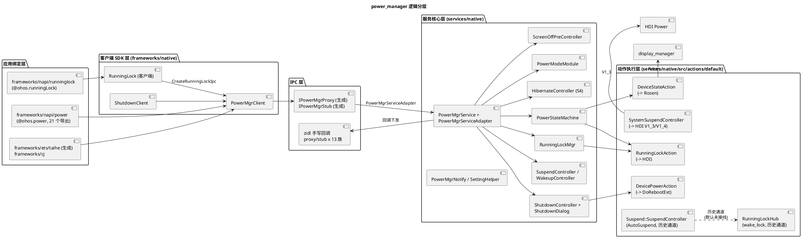

# 架构设计及约束

## 架构设计

### 设计原则
| 原则 | 描述 | 理由 |
|---|---|---|
| 客户端零业务状态 | `PowerMgrClient` 仅做 IPC 转发、连接与死亡重连（CONNECT_RETRY_COUNT=5，`interfaces/inner_api/native/include/power_mgr_client.h:37-38`）；RunningLock 对象也只持 token，实际生效由服务端仲裁 | 所有业务状态收敛于服务端，避免多客户端状态漂移；服务死亡后客户端可自动重建（`RecoverRunningLocks`，`power_mgr_client.h:430`） |
| 状态机单一入口 | 任何电源状态变更必须经 `PowerStateMachine::SetState`（`power_state_machine.cpp:2241`），由 forbidMap/allowMapByReason/lockMap 三表仲裁 | 状态转移规则集中可审计；绕过将破坏亮灭屏与休眠时序（`AGENTS.md` 架构不变量） |
| IPC 双轨制 | 主接口 `IPowerMgr.idl` 经 `idl_gen_interface("powermgr_interface")` 生成 proxy/stub（`interfaces/inner_api/BUILD.gn:44,53,82`）；13 类回调方向的 proxy/stub 手写在 `services/zidl/`（50 文件） | 请求方向由工具生成保证参数编解码一致；回调方向需精细控制优先级与死亡清理故手写 |
| actions 层隔离外部执行 | 显示动作经 `DeviceStateAction`→Rosen；关机重启经 `DevicePowerAction`→`DoRebootExt`；睡眠与 HDI 经 `SystemSuspendController`；业务层不直接触碰 HDI/sysfs | 换执行通道（如标准版/默认版 actions 差异）不影响业务逻辑；HDI 版本依赖可集中管理 |
| 执行通道收敛于 HDI | 睡眠/唤醒/持锁全部经 `SystemSuspendController` 收敛到 HDI Power（Suspend→ForceSuspend/StartSuspend、Wakeup→StopSuspend、持锁→Hold/UnholdRunningLockExt，system_suspend_controller.cpp:198-266）；`actions/default/suspend/` 下的 sysfs 实现（AutoSuspend+wakeup_count、RunningLockHub wake_lock）为保留的历史通道，默认流程不再调用（仅 test/unittest/src/running_lock_hub_native_test.cpp 引用） | HDI 承载厂商定制（唤醒原因、锁下沉）；sysfs 版本留存作为无 HDI 形态的参考实现与测试资产 |
| 配置驱动事件源 | 唤醒/休眠源由 profile JSON 声明（`power_wakeup.json`/`power_suspend.json`），运行期可被设置项覆盖 | 无需改代码即可裁剪产品形态的唤醒/休眠行为 |
| 特性开关条件编译 | `powermgr.gni` declare_args 45 个开关 → defines → `#ifdef`（`powermgr.gni:16-116`），与 `bundle.json` features（43 项）联动 | 单一代码基线覆盖手机/穿戴/TV/平板等形态 |

### 逻辑架构

分层说明：
- **应用绑定层**：`@ohos.power` 导出 shutdown/reboot/wakeup/suspend/hibernate/setPowerMode 等 21 个函数与 DevicePowerMode 枚举（`frameworks/napi/power/power_module.cpp:110-138`）；`@ohos.runningLock` 导出 create/hold/isHolding/unhold 等（`frameworks/napi/runninglock/runninglock_module.cpp:60-138`）。
- **客户端 SDK 层**：`PowerMgrClient`（单例 + 死亡通知 + 代理重建，`power_mgr_client.h:413-427`）；`RunningLock` 客户端持有 token + 超时参数（`interfaces/inner_api/native/include/running_lock.h:29-69`）；`frameworks/native/shutdown/shutdown_client.cpp` 提供关机客户端。
- **IPC 层**：`IPowerMgr.idl`（141 行）声明主接口与 13 个回调接口（`IPowerMgr.idl:16-31`）；`services/zidl/` 手写回调方向 proxy/stub（power_state_callback、sync_sleep、sync_hibernate、power_mode、screen_off_pre、takeover_shutdown、async/sync_shutdown、power_runninglock、takeover_suspend、ulsr、running_lock_changed、power_mgr_async_reply）。
- **服务核心层**：`PowerMgrService : SystemAbility(3301, true)`（`power_mgr_service.cpp:164`）实现全部业务方法（`power_mgr_service.h:68-184`）；`PowerMgrServiceAdapter : PowerMgrStub` 承接生成 stub 的 *Ipc 方法再转发（`power_mgr_service_ipc_adapter.h:27-36`）。
- **动作执行层**：`actions/default` 为默认实现（另有 `standard` 变体目录），是业务与外部的唯一通道。

### 非功能设计
| 场景类别 | 方案设计 |
|---|---|
| 可靠性 | 客户端/服务端双向死亡通知（`PowerMgrDeathRecipient`、`RunningLockDeathRecipient`、各 CallbackMgr 继承 DeathRecipient）；HDI 服务状态监听 `hdi_service_status_listener` + `ResetHandle` 重试（`system_suspend_controller.h:47,58`）；SA 监听 7 个外部系统服务延迟初始化（`power_mgr_service.cpp:182-193`） |
| 并发 | 服务核心用 FFRT（ffrt::mutex、FFRTTimer、FFRTQueue）；状态字段受 `stateMutex_` 保护且约定"currentState_ 变更须在锁内"（`power_state_machine.h:493-495`）；SetState 内用 ffrt::this_task::get_id 感知定时任务身份 |
| 性能 | 唤醒走 oneway（WakeupDeviceAsyncIpc，`IPowerMgr.idl:60`）；SetState 超时 400/1000ms 埋点（`power_state_machine.cpp:2291-2320`）；ULSR/带 tag 挂起面向低时延场景（默认关闭） |
| 资源安全 | sysfs 用 UniqueFd（`running_lock_hub.h:48-49`）；SleepGuard RAII 防睡眠窗口漏锁（`wakeup_controller.h:83-95`）；SettingStateFlag RAII 标记 DIM 打断（`power_state_machine.h:338-368`）；init 脚本预授权 /sys/power/*（`etc/init/powermgr.cfg`） |
| 兼容性 | `libpowermgr_client.map` 版本脚本约束导出符号；HDI 最低版本 libpower_proxy_1.3 声明于 sa_profile；IPC 码由 .idl 顺序生成，新增只能追加 |

## 架构约束
- **状态字段仅经状态机修改**
  - **what**：`PowerStateMachine` 的 `currentState_` 只能在 `stateMutex_` 内、经 `SetState`→`StateController::TransitTo` 修改（`power_state_machine.cpp:2241-2289`）。
  - **why**：亮灭屏/休眠时序依赖 forbidMap 仲裁；旁路修改会导致显示状态与电源状态不一致，触发 STATE_CORRECTION 纠偏事件（`powermanager.yaml`）。
- **HDI 与 sysfs 只允许 actions 层触碰**
  - **what**：业务类禁止直接 include HDI 头或打开 /sys/power 路径；唯一例外是 `SystemSuspendController`（HDI 门面）与 `Suspend::SuspendController`/`RunningLockHub`（sysfs 门面）。
  - **why**：HDI 版本（V1_2/V1_3/V1_4 混用）与厂商代理耦合，分散调用会在 `min_hdi_proxy_version` 升级时全面失效。
- **多 SA 共进程不阻塞**
  - **what**：powermgr 进程同时承载 SA 3301/3302/3303/3308；关机/休眠路径禁止长耗时同步 IO 与大内存分配（AGENTS.md 禁止事项）。
  - **why**：一个 SA 阻塞会拖死整个电源子系统（电量、温度、显示同时失效）。
- **回调注册必须带死亡清理**
  - **what**：所有 CallbackHolder/CallbackMgr 以 IRemoteObject 为键持有，统一实现 OnRemoteDied 清理（如 `running_lock_mgr.h:158-163`、`screen_off_pre_controller.h:41-51`）。
  - **why**：客户端异常退出后残留回调会导致后续关机/灭屏流程卡死等待已死进程。
- **IPC 码值稳定**
  - **what**：`IPowerMgr.idl` 方法顺序即码值顺序（ipccode 0 起连续，`.idl:34`），已发布接口不得插入/重排；回调手写码同理成对修改。
  - **why**：旧客户端按码值寻址，错位会调用到错误接口（AGENTS.md 项目特定陷阱）。
- **特性开关双写**
  - **what**：`powermgr.gni` 的 declare_args 默认值与对应 defines 映射、`bundle.json` features 三处同步（`powermgr.gni:16-116`）。
  - **why**：漏改一处会导致产品形态开关失效或构建配置漂移。
