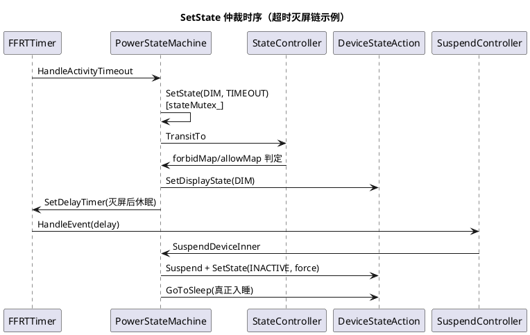

# 技术术语知识

power_manager 模块核心技术框架和机制的知识定义，涵盖价值认知、原理、使用方式和代码关联。业务实体定义见 [业务实体知识](powermgr-Entity.md)，架构分层见 [架构设计](architecture.md)。

## IPC 双轨机制（IDL 生成 + 手写回调）

### 解决的问题（Problem）
| 子维度 | 内容 |
|---|---|
| 业务痛点 | 电源服务接口面大（约 75 方法、13 类回调）且需要跨版本稳定；回调侧还需优先级排序、异步回包与死亡清理等生成器不易表达的语义 |
| 技术目标 | 请求方向零手写编解码错误；回调方向精细可控；新旧客户端码值兼容 |

### 原理（Principles）
| 子维度 | 内容 |
|---|---|
| 核心机制 | `IPowerMgr.idl` 声明接口体，`idl_gen_interface("powermgr_interface")` 生成 powermgr_proxy/powermgr_stub（interfaces/inner_api/BUILD.gn:44,53,82）；码值按声明顺序自 ipccode 0 连排（IPowerMgr.idl:34）；回调接口（IPowerStateCallback 等 13 个，:19-31）在 zidl 手写 proxy/stub 成对实现；异步强休/休眠经 `IPowerMgrAsync` 参数携带客户端回包代理，服务端完成后 SendAsyncReply(reply) 回包 |
| 关键流程 | 客户端调用 → 生成 proxy 编码（首个方法 CreateRunningLockIpc 带 TF_IMAGE 自定义消息选项，IPowerMgr.idl:34）→ PowerMgrServiceAdapter : PowerMgrStub 解码（power_mgr_service_ipc_adapter.h:27-36）→ PowerMgrService 业务方法 → 结果原路返回；服务端反向经 zidl 手写 proxy 调客户端 stub |

### 使用方式（Usage）
| 子维度 | 内容 |
|---|---|
| 核心 API | 客户端 `PowerMgrClient::GetInstance()` 全量方法（power_mgr_client.h:44-408）；`ForceSuspendDeviceIpc`/`HibernateIpc` 为 oneway，结果经 IPowerMgrAsync 通知（IPowerMgr.idl:68,89）；新增接口只能追加 .idl 尾部 + zidl 成对文件 |

### 代码关联（Code）
| 子维度 | 内容 |
|---|---|
| 核心类 | IPowerMgr（生成）、PowerMgrServiceAdapter、power_mgr_async_reply_proxy/stub（services/zidl） |
| 核心成员 | sptr<IPowerMgr> proxy_ + PowerMgrDeathRecipient（power_mgr_client.h:427-428） |
| 核心方法 | Connect/ResetProxy（power_mgr_client.h:424-426）、SendAsyncReply（services/zidl/power_mgr_async_reply.h） |

### 约束与限制（Constraints）
| 子维度 | 内容 |
|---|---|
| 系统限制 | 码值为 ABI 契约：插入/重排即旧客户端错位调用（AGENTS.md 陷阱）；`libpowermgr_client.map` 冻结导出符号 |
| 并发约束 | 回调触发线程不定，Holder 须 ffrt::mutex；死亡通知在 binder 线程执行清理 |
| 安全约束 | 写操作权限校验必须在服务端入口（AGENTS.md 架构不变量），不依赖客户端自律 |

## 电源状态机转移机制

### 解决的问题（Problem）
| 子维度 | 内容 |
|---|---|
| 业务痛点 | 亮灭屏/休眠时序涉及显示、输入、传感器多方并发请求，无序变更会造成状态与屏幕不一致、唤醒丢失、重复灭屏 |
| 技术目标 | 单入口仲裁、规则可配置、时序可观测 |

### 原理（Principles）
| 子维度 | 内容 |
|---|---|
| 核心机制 | SetState 持 stateMutex_ 后依次：CheckFFRTTaskAvailability（以 ffrt 任务 id 作废过期定时任务）→ ScreenChangeCheck 超时上报 RAII → SettingStateFlag（DIM 打断标记）→ GetStateController 取目标态控制器 → forceTimingOut_ 时升级 force → TransitTo（forbidMap 禁止表 + allowMapByReason 原因放行表 + lockMap 运行锁阻塞表三重判定，power_state_machine.cpp:81-199,2241-2289） |
| 关键流程 | 超时链：ResetInactiveTimer 设 FFRT 定时器 → HandleActivityTimeout → SetState(DIM) → 再超时 SetState(INACTIVE) → SuspendController::HandleEvent → SLEEP；每次迁移写 HiSysEvent（SCREEN_STATE_TRANSIT_FAILED / INTERFACE_CONSUMING_TIMEOUT，阈值 400/1000ms，:2291-2320） |



### 使用方式（Usage）
| 子维度 | 内容 |
|---|---|
| 核心 API | 内部触发：SuspendDeviceInner/WakeupDeviceInner/RefreshActivityInner（:546/:710/:772）；外部只经 PowerMgrClient 对应方法间接触发 |

### 代码关联（Code）
| 子维度 | 内容 |
|---|---|
| 核心类 | PowerStateMachine、StateController（services/native/include/power_state_machine.h） |
| 核心成员 | forbidMap_(:507)、allowMapByReason_(:514)、lockMap_(:491)、controllerMap_(:431-439)、stateMutex_(:494) |
| 核心方法 | SetState（.cpp:2241）、CanTransitTo（:230）、InitTransitMap（:138）、InitAllowMapByReason（:163） |

### 约束与限制（Constraints）
| 子维度 | 内容 |
|---|---|
| 系统限制 | SHUTDOWN/HIBERNATE 终态不可逆；INACTIVE→DIM 禁止（防变暗闪烁）；双击/拾起唤醒受传感器状态门控（CanTransitTo） |
| 并发约束 | currentState_ 只能在 stateMutex_ 内变更（头文件注释 :493-495）；定时任务用任务 id 自证有效 |
| 安全约束 | 状态迁移失败必须落 FAULT 事件，禁止静默吞结果 |

## 睡眠执行机制（HDI 通道与 wakeup_count 历史协议）

### 解决的问题（Problem）
| 子维度 | 内容 |
|---|---|
| 业务痛点 | 系统入睡需要与厂商电源固件协同（唤醒原因统计、按 tag 选择睡眠模式），且直写 /sys/power/state 的朴素做法会在"读到无唤醒事件"与"入睡"之间丢失新事件 |
| 技术目标 | 睡眠/唤醒全部经 HDI 收敛（厂商可定制）；同时保留 wakeup_count 协议实现作为无 HDI 形态的参考与测试资产 |

### 原理（Principles）
| 子维度 | 内容 |
|---|---|
| 核心机制 | 生产路径：DeviceStateAction::GoToSleep（device_state_action.cpp:303-308）→ SystemSuspendController::Suspend：force 时 HDI ForceSuspend、否则 allowSleepTask_ 放行后 StartSuspend（system_suspend_controller.cpp:198-201）；唤醒为 HDI StopSuspend（DeviceStateAction::Wakeup :61）；睡/醒两侧经 PowerHdfCallback（V1_2 OnSuspend/OnWakeup）上抛。历史路径（默认不调用）：AutoSuspend 守护线程按 wakeup_count 协议循环（actions/default/suspend/suspend_controller.h:46-71）——WaitWakeupCount 读计数、WriteWakeupCount 原样写回成功后向 /sys/power/state 写 "mem"，失败 100ms 重试，SuspendBlockCounter>0 时挂起循环 |
| 关键流程 | 状态机入睡 → GoToSleep → HDI StartSuspend/ForceSuspend（DO_SUSPEND/SUSPEND_STATISTIC 事件，.cpp:192-196）→ 唤醒源事件 → WakeupController → 状态机 AWAKE + SuspendController::StopSleep → HDI StopSuspend；显示完成经 DisplayPowerCallback（WakeUpEnd/SuspendEnd + DISPLAY_ON/OFF_DONE，device_state_action.cpp:315-342） |

### 使用方式（Usage）
| 子维度 | 内容 |
|---|---|
| 核心 API | 仅 actions 层内部使用；业务经状态机/DeviceStateAction::GoToSleep 间接触发；AllowAutoSleep/DisallowAutoSleep 控制休眠放行（system_suspend_controller.h:50-51） |

### 代码关联（Code）
| 子维度 | 内容 |
|---|---|
| 核心类 | SystemSuspendController、PowerHdfCallback（生产）；Suspend::SuspendController::AutoSuspend（历史） |
| 核心成员 | allowSleepTask_、powerInterface_（V1_3）、WAKEUP_HOLDER（system_suspend_controller.h:63,80,84）；历史通道 wakeupCountFd/daemon_（suspend_controller.h:64-67） |
| 核心方法 | Suspend/Wakeup（system_suspend_controller.h:40-41，.cpp:181-216）、ForceSuspendEx（:150）、AutoSuspendLoop/SuspendEnter（suspend_controller.h:51,54，历史） |

### 约束与限制（Constraints）
| 子维度 | 内容 |
|---|---|
| 系统限制 | HDI 版本下限 libpower_proxy_1.3（sa_profile）；/sys/power/* 由 etc/init/powermgr.cfg 预授权（供历史通道与内核侧使用） |
| 并发约束 | HDI 调用串行在 FFRTQueue "power_system_suspend_controller"；历史守护线程与业务经 condition_variable 同步（不在默认路径） |
| 安全约束 | 入睡路径禁止大内存分配/阻塞 IO（低内存执行） |

## 唤醒源管理机制（JSON 配置 + Monitor 族 + pre-bright）

### 解决的问题（Problem）
| 子维度 | 内容 |
|---|---|
| 业务痛点 | 唤醒事件源形态多样（按键/触摸/传感器/盖板），不同产品裁剪差异大；亮屏前授权类场景需"先亮后验证" |
| 技术目标 | 配置声明式注册、设置项热更新、事件去抖与预亮流程统一 |

### 原理（Principles）
| 子维度 | 内容 |
|---|---|
| 核心机制 | power_wakeup.json 按源声明 enable/click（wakeup_sources.h:60-72 定义键名与 SINGLE/DOUBLE 映射）；WakeupController::Init 逐源 CreateMonitor（11 种 Monitor 子类各订阅 MMI/传感器/switch）；事件到达经 listener_(reason)→HandleWakeup→状态机 WakeupDeviceInner；设置项变更走 WakeupParseJsonConfig 重建（ChangeWakeupSourceConfig 静态族，wakeup_controller.h:59-66） |
| 关键流程 | pre-bright 预亮：WAKEUP_DEVICE_PRE_BRIGHT 族 → HandlePreBrightWakeUp：StopSleep + stateAction_->Wakeup + SetState(AWAKE) → 等授权（CHECK_PRE_BRIGHT_AUTH_TIMEOUT_MSG 兜底）→ 成功 TriggerSyncSleepCallback(true)/失败 StartSleepTimer 回睡（power_state_machine.cpp:638-690） |

### 使用方式（Usage）
| 子维度 | 内容 |
|---|---|
| 核心 API | 设置项（settings.power.wakeup_sources 等 JSON，setting_provider.h:66）在线改写；代码侧静态方法 PickupConnectMotionConfig 联动 MSDP；ExecWakeupMonitorByReason 供动作匹配（wakeup_controller.h:51） |

### 代码关联（Code）
| 子维度 | 内容 |
|---|---|
| 核心类 | WakeupController、WakeupMonitor 11 子类、InputCallback（services/native/src/wakeup/） |
| 核心成员 | sourceList_、monitorMap_（wakeup_controller.h:106-107）、eventHandleMap_ 去抖表（:108） |
| 核心方法 | RegisterMonitor（:46）、CheckEventReciveTime（:75）、HandlePreBrightWakeUp（power_state_machine.cpp:638）、IsWakeupDeviceSkip（:692） |

### 约束与限制（Constraints）
| 子维度 | 内容 |
|---|---|
| 系统限制 | 双击/拾起/运动依赖 sensor/MSDP 能力（IsMovementStateOn dlopen libpower_manager_ext.z.so，power_state_machine.cpp:206-227）；翻盖需 const.power.enable_lid_check |
| 并发约束 | mmiMonitorMutex_ 保护输入订阅；传感器回调线程直接进入业务需去抖（CheckEventReciveTime） |
| 安全约束 | 开关关闭/休眠态/合盖态唤醒被 IsWakeupDeviceSkip 拦截并可经 SwitchAction 下发厂商动作（:703-706） |

## 运行锁机制（LockCounter + HDI 下沉 + 代理恢复）

### 解决的问题（Problem）
| 子维度 | 内容 |
|---|---|
| 业务痛点 | 大量业务并发持锁/放锁，需要计数仲裁、进程死亡自动释放、后台任务节能时批量失效与恢复 |
| 技术目标 | 同型多锁正确合并；锁与休眠阻塞关系明确；代理状态可恢复 |

### 原理（Principles）
| 子维度 | 内容 |
|---|---|
| 核心机制 | 客户端 token（IRemoteObject）为键；RunningLockMgr 每型一个 LockCounter，Increase/Decrease 触发 activate 回调（running_lock_mgr.h:121-144）→ RunningLockAction → SystemSuspendController::Acquire/ReleaseRunningLock → HDI Hold/UnholdRunningLockExt（running_lock_action.cpp:26-34；system_suspend_controller.cpp:253-266）；死亡经 RunningLockDeathRecipient 释放；代理：ProxyRunningLocks 把指定 pid/uid 锁置 PROXIED（不计阻塞），恢复走 UNPROXIED_RESTORE（running_lock_inner.h:27-32） |
| 关键流程 | Lock：CreateRunningLock → Lock(timeoutMs) → LockCounter::Increase → HDI HoldRunningLockExt 下沉 + RUNNINGLOCK HiSysEvent；超时由 running_lock_timer_handler 定时 UnLock |

### 使用方式（Usage）
| 子维度 | 内容 |
|---|---|
| 核心 API | PowerMgrClient::CreateRunningLock(name,type[,displayId]) + RunningLock::Lock(timeOutMs=-1)/UnLock；系统侧 ProxyRunningLocks/ResetRunningLocks（power_mgr_client.h:276-282）；查询 QueryRunningLockLists/IsRunningLockEnabled（:229,310） |

### 代码关联（Code）
| 子维度 | 内容 |
|---|---|
| 核心类 | RunningLockMgr、LockCounter、RunningLockInner、RunningLockHub |
| 核心成员 | runningLocks_、lockCounters_（running_lock_mgr.h:181-182）、runningLockMap_ sysfs 计数（running_lock_hub.h:52） |
| 核心方法 | CreateRunningLock（:52）、Lock/UnLock（:57-58）、LockInnerByProxy/UnlockInnerByProxy（:88-89）、CheckRunningLock（power_state_machine.cpp:1815） |

### 约束与限制（Constraints）
| 子维度 | 内容 |
|---|---|
| 系统限制 | 只有 SCREEN 型阻塞 INACTIVE 转移、COORDINATION 型阻塞 SLEEP 转移（power_state_machine.cpp:81-116）；USER_IDLE 型不能阻止强休、须监听 ENTER_FORCE_SLEEP 自行释放（running_lock_info.h:73-79） |
| 并发约束 | 双锁分区（mutex_/screenLockListsMutex_）；音频锁 IsExistAudioStream 特判可豁免代理（audio_lock_unproxy 开关） |
| 安全约束 | 每次 Hold/Unhold 写 RUNNINGLOCK 统计事件（含 pid/uid/name/type，powermanager.yaml） |

## 关机重启机制（回调三族 + HookMgr + 弹窗时序）

### 解决的问题（Problem）
| 子维度 | 内容 |
|---|---|
| 业务痛点 | 关机前各子系统需要有序收尾（先问询、再异步通知、后同步等待），且交互上需弹窗确认、厂商需可定制重启命令 |
| 技术目标 | 分阶段可控执行；60 秒硬上限；产品可插拔 |

### 原理（Principles）
| 子维度 | 内容 |
|---|---|
| 核心机制 | RebootOrShutdown 顺序：TakeOverShutdownAction 问询接管回调（可中止）→ Prepare（TurnOffScreen + PublishShutdownEvent）→ TriggerAsyncShutdownCallback（不等）→ TriggerSyncShutdownCallback（按优先级阻塞等待）→ DevicePowerAction：HookMgr POWER_PRE_DO_REBOOT 钩子可改写 rebootCmd（如 reason 含 updater 时映射 UPDATER_CMD）→ DoRebootExt 落地（device_power_action.cpp:34-60） |
| 关键流程 | 电源键长按：PowerKeySuspendMonitor 长按 3000ms → ShutdownDialog::ConnectSystemUi 拉起 power_dialog → 用户选择/超时 → 回包后走关机/重启；期间 KeyMonitor 监测按键防误触 |

```plantuml
@startuml
title 关机流程时序
participant "SuspendController\n(PowerKey 监测)" as PK
participant "PowerMgrService" as PMS
participant "ShutdownController" as SC
participant "ShutdownDialog" as SD
participant "DevicePowerAction" as DPA

PK -> SD : 长按 3s，StartDialog
SD -> SD : ConnectSystemUi\n(power_dialog ArkTS)
SD --> PMS : 用户选择 shutdown
PMS -> SC : ShutDownDevice(reason)
SC -> SC : TakeOver 回调问询\n(可中止)
SC -> SC : Async 回调通知
SC -> SC : Sync 回调(阻塞等待)
SC -> DPA : Shutdown(reason)
DPA -> DPA : HookMgr POWER_PRE_DO_SHUTDOWN\n(poweroff_charge 定制)
DPA -> [startup init] : DoRebootExt("shutdown", reason)
@enduml
```

### 使用方式（Usage）
| 子维度 | 内容 |
|---|---|
| 核心 API | PowerMgrClient::RebootDevice/ForceRebootDevice/ShutDownDevice（:44-63）；回调注册 RegisterShutdownCallback(takeover/sync)/RegisterAsyncShutdownCallback（:352-360）；GetShutdownReason（:343） |

### 代码关联（Code）
| 子维度 | 内容 |
|---|---|
| 核心类 | ShutdownController、ShutdownDialog、DevicePowerAction、ShutdownCallbackHolder |
| 核心成员 | 三桶 holder（shutdown_controller.h:83-85）、started_（:87）、isShutdownDialogForbid_（shutdown_dialog.h:69） |
| 核心方法 | RebootOrShutdown（:65）、TakeOverShutdownAction（:69）、DoRebootExt 调用（device_power_action.cpp:48,59） |

### 约束与限制（Constraints）
| 子维度 | 内容 |
|---|---|
| 系统限制 | ForceReboot 忽略 takeover 且 60 秒内必达 DoRebootExt（power_mgr_client.h:47-55）；弹窗等待禁止改同步阻塞（AGENTS.md） |
| 并发约束 | started_ 防重入；takeover 回调内再触发关机即死锁（AGENTS.md 陷阱） |
| 安全约束 | 关机/重启权限校验在服务端；DoShutdown 走 HiSysEvent 上报 |

## 亮灭屏超时机制（活动刷新与 DIM 链）

### 解决的问题（Problem）
| 子维度 | 内容 |
|---|---|
| 业务痛点 | 屏幕保亮窗口既要响应各类用户活动（触摸/按键/无障碍），又要按超时分级变暗、灭屏、入睡，并支持窗口/应用临时覆盖超时 |
| 技术目标 | 100ms 节流；DIM 可打断；超时值多来源（设置/窗口覆盖/充电形态/档位策略）可叠加 |

### 原理（Principles）
| 子维度 | 内容 |
|---|---|
| 核心机制 | RefreshActivityInner：屏亮且非 INACTIVE 时刷新（power_state_machine.cpp:772-800）；两次刷新至少间隔 100ms（CheckRefreshTime，:802-810）；ResetInactiveTimer 先以原子交换打断进行中的 DIM（SETTING_DIM_INTERRUPTED，:1532-1538）再重设 FFRT 定时器；超时后 AWAKE→DIM→INACTIVE→（灭屏后 delay）→SLEEP；OverrideScreenOffTime 临时覆盖、Restore 恢复（:813/:825）；显示超时来源链：档位策略 > 窗口覆盖 > AC/DC 设置 > 默认 30000ms（charging 形态 600000/300000） |
| 关键流程 | 无活动 → HandleActivityTimeout → SetState(DIM,TIMEOUT)（MAX_DIM_TIME_MS=7500 上限）→ HandleActivitySleepTimeout → SetState(INACTIVE) → SuspendController::HandleEvent → 入睡 |

### 使用方式（Usage）
| 子维度 | 内容 |
|---|---|
| 核心 API | PowerMgrClient::RefreshActivity(type[,reason])（:106-115）；OverrideScreenOffTime/RestoreScreenOffTime（:121-126）；SetForceTimingOut 强制到期（:239）；LockScreenAfterTimingOut 定制锁屏行为（:263-274） |

### 代码关联（Code）
| 子维度 | 内容 |
|---|---|
| 核心类 | PowerStateMachine（定时器事件族 :90-98） |
| 核心成员 | settingStateFlag_（:338-368）、forceTimingOut_、displayOffTime 缓存 |
| 核心方法 | RefreshActivityInner（:772）、ResetInactiveTimer（:1532）、SetDelayTimer（:1424）、OverrideScreenOffTimeInner（:813） |

### 约束与限制（Constraints）
| 子维度 | 内容 |
|---|---|
| 系统限制 | 屏灭时 RefreshActivity 被忽略（:797-799）；POWER_MANAGER_ENABLE_SCREEN_DECOUPLING 开启后灭屏与入睡解耦（默认耦合） |
| 并发约束 | DIM 竞态由 SettingStateFlag 原子交换收敛；定时任务身份由 ffrt 任务 id 校验 |
| 安全约束 | 亮灭屏超时（SCREEN_ON/OFF_TIMEOUT）双埋点 FAULT 事件（powermanager.yaml） |

## 电源模式策略机制（XML 下发与恢复）

### 解决的问题（Problem）
| 子维度 | 内容 |
|---|---|
| 业务痛点 | 省电/性能档位需要同时调整一批系统设置（超时/亮度/振动/旋转等），且退出时要精确还原用户原值 |
| 技术目标 | 策略数据驱动；模式间转移受控；开机重放与异常恢复 |

### 原理（Principles）
| 子维度 | 内容 |
|---|---|
| 核心机制 | PowerSaveMode 解析 power_mode_config.xml 得 policyCache_[mode]=list<ModePolicy{id,value,recover_flag}>（power_save_mode.h:33-57）；SetModeItem→EnableMode：UpdateModepolicy 逐项执行 RunAction 的八个 Set*（亮度用 SETTINGS_PRIVIDER_VALUE_LCD_BRIGHTNESS=99 等恢复值，power_mode_module.h:30-34）；recover_flag 决定回 NORMAL 时恢复；SaveCurrentMode/ReadPowerModeRecoverMap 持久化现场 |
| 关键流程 | 应用 SetDeviceMode → 状态机无关（模式不改电源状态）→ 广播 POWER_MODE 回调 + 公共事件；设置侧改模式键 → PowerModeSettingUpdateFunc 反向同步（power_mgr_service.cpp:336-346） |

### 使用方式（Usage）
| 子维度 | 内容 |
|---|---|
| 核心 API | PowerMgrClient::SetDeviceMode/GetDeviceMode（:194-201）；NAPI setPowerMode/getPowerMode（power_module.cpp:130-131）；RegisterPowerModeCallback（:294-295） |

### 代码关联（Code）
| 子维度 | 内容 |
|---|---|
| 核心类 | PowerModeModule、PowerSaveMode |
| 核心成员 | policyCache_（power_save_mode.h:54）、forbidMap_（power_mode_module.h:84）、callbackMgr_（:98） |
| 核心方法 | SetModeItem/EnableMode（:47,50）、UpdateModepolicy（:99）、SetDisplayOffTime（:101） |

### 约束与限制（Constraints）
| 子维度 | 内容 |
|---|---|
| 系统限制 | PERFORMANCE_MODE 受 enable_performance_mode 开关（默认 false）；EXTREME/CUSTOM 档为穿戴/定制形态 |
| 并发约束 | once_flag isReady_ 保证 InitPowerMode 单次；回调 WaitingCallback 收敛多客户端 |
| 安全约束 | 设置写入经 SettingProvider（settingsdata 权限体系），不改系统参数 |

## 设置与系统参数机制（SettingProvider + ParamCacher + para）

### 解决的问题（Problem）
| 子维度 | 内容 |
|---|---|
| 业务痛点 | 电源行为键多（超时/唤醒源/模式/开关族），既有需即时观察的用户设置，也有只读的厂商/系统常量 |
| 技术目标 | 读写订阅统一门面；多用户切换正确；高频参数缓存 |

### 原理（Principles）
| 子维度 | 内容 |
|---|---|
| 核心机制 | SettingProvider 封装 DataShare（GetInstance(systemAbilityId) + Get/Put 四型值 + CreateObserver，setting_provider.h:25-43）；SettingHelper 静态门面按域组织键（setting_helper.h:34-114）；系统参数两级：etc/para/powermgr.para 声明默认值（const.power.* 只读、persist.dfx.* 可写），服务启动时读入；ParamCacher 缓存高频查询（active_time_before_long_time_dim/IsNeverSleepDimEnabled，power_state_machine.cpp:1545-1548） |
| 关键流程 | 键变更 → DataShare 回调 → SettingObserver::UpdateFunc → 控制器重建（如唤醒源 JSON → WakeupParseJsonConfig → 新 Monitor 生效） |

### 使用方式（Usage）
| 子维度 | 内容 |
|---|---|
| 核心 API | 仅服务端内部：SettingHelper::Register*Observer / Get/Set*；跨仓共享仅 SettingProvider 层（utils/ 约束） |

### 代码关联（Code）
| 子维度 | 内容 |
|---|---|
| 核心类 | SettingProvider（utils/setting）、SettingHelper、ParamCacher（services/native/include/param_cacher.h） |
| 核心成员 | AOD 键常量（setting_helper.h:26）、AC/DC 键族（:42-60） |
| 核心方法 | SettingProvider::CreateObserver/RegisterObserver（setting_provider.h:38-41）、UpdateCurrentUserId（:42） |

### 约束与限制（Constraints）
| 子维度 | 内容 |
|---|---|
| 系统限制 | utils/ 为跨仓层禁加 power 私有键（AGENTS.md）；键先 Is*SettingValid 校验防脏数据 |
| 并发约束 | DataShare 回调线程禁重入 Put；多用户经 UpdateCurrentUserId 切库 |
| 安全约束 | const.* 参数设备级只读；persist.dfx.* 仅诊断用途 |

## 通知与 DFX 机制（公共事件 + HiSysEvent + Hitrace + 诊断）

### 解决的问题（Problem）
| 子维度 | 内容 |
|---|---|
| 业务痛点 | 全系统业务需要感知电源状态（锁屏/通话/统计），质量侧需要定位亮灭屏异常与迁移失败 |
| 技术目标 | 状态广播低延迟；关键路径全程可观测；问题可现场取证 |

### 原理（Principles）
| 子维度 | 内容 |
|---|---|
| 核心机制 | PowerMgrNotify 预构建 Want + CommonEventPublishInfo 发布亮/灭/强休/S4 事件（power_mgr_notify.h:31-58）；HiSysEvent 双 domain：POWER（RUNNINGLOCK/SCREEN/STATE 统计、SCREEN_ON/OFF_TIMEOUT、STATE_CORRECTION、SCREEN_STATE_TRANSIT_FAILED 故障，powermanager.yaml）与 POWER_UE（亮灭屏行为）；Hitrace TAG_POWER 包裹 SuspendDevice/WakeupDevice（power_state_machine.cpp:549-551,713-715）；SetState 超时 400/1000ms 埋 INTERFACE_CONSUMING_TIMEOUT（:2291-2320） |
| 关键流程 | 状态迁移完成 → Notify Publish*Events + 回调族 + POWER_UE 事件 → HiView 聚合；hidumper/power-shell dump → ShellDumpIpc → PowerMgrDumper::Dump 输出状态机/运行锁/休眠栈快照 |

### 使用方式（Usage）
| 子维度 | 内容 |
|---|---|
| 核心 API | 订阅侧：公共事件（usual.event.SCREEN_ON/OFF 等）+ IPowerStateCallback；诊断侧：`hidumper -s 3301`、power-shell（tools/ohos-powerManager，support_power_cli 默认 false） |

### 代码关联（Code）
| 子维度 | 内容 |
|---|---|
| 核心类 | PowerMgrNotify、PowerMgrDumper、POWER_HILOG 宏体系 |
| 核心成员 | screenOn/OffWant_（power_mgr_notify.h:49-50）、日志域表（utils/native/include/power_log.h:79-124） |
| 核心方法 | PublishScreenOffEvents（power_mgr_notify.h:32）、PowerMgrDumper::Dump（power_mgr_dumper.h:30）、WriteHiSysEvent（power_state_machine.cpp:2291） |

### 约束与限制（Constraints）
| 子维度 | 内容 |
|---|---|
| 系统限制 | 禁删事件/日志换测试通过（AGENTS.md）；强休/S4 事件受对应特性开关门控 |
| 并发约束 | 事件发布在 FFRT；发布失败不阻塞主流程 |
| 安全约束 | 事件内容不含敏感信息（reason 字符串白名单来自枚举转字符串） |

## 特性休眠族机制（S4 / ULSR / 忽略锁强休）

### 解决的问题（Problem）
| 子维度 | 内容 |
|---|---|
| 业务痛点 | 标准产品仅需 S3，但穿戴/车机/平板需要 S4 磁盘休眠、ULSR 低时延挂起、忽略运行锁的强制休眠等特殊形态 |
| 技术目标 | 单代码基线条件编译；特殊路径不污染默认流程；与 HDI 版本协同 |

### 原理（Principles）
| 子维度 | 内容 |
|---|---|
| 核心机制 | 三特性独立开关：enable_s4（S4，HibernateController + const.power.enable_s4 运行时门控）；enable_suspend_with_tag/enable_ulsr_plugin（SetSuspendTag + IUlsrCallback 桶 + CHECK_ULSR_SYNC_CALLBACK_TIMEOUT_MSG 定时器）；enable_force_suspend_ignoring_wakelock（ForceSuspendDeviceIgnoringWakelock：tag 仅 "mem"/"ulsr"，经 V1_4 HDI ForceSuspendEx，回调等待 30000ms 超时 + InterruptForceSuspend 打断 + 回滚，suspend_controller.h:137-147,163-189） |
| 关键流程 | 强休：ForceSuspendDeviceIgnoringWakelockIpc（oneway）→ StartForceSuspendCallbacks → DoHdiForceSuspendEx → WaitForceSuspendCallbacks（cv）→ 成功入睡/打断则 ScheduleWakeupAfterInterrupt + Rollback |

### 使用方式（Usage）
| 子维度 | 内容 |
|---|---|
| 核心 API | PowerMgrClient::Hibernate(clearMemory,reason)（:188）、SetSuspendTag(tag)（:73）、ForceSuspendDeviceIgnoringWakelock/InterruptForceSuspend（:165-171）、RegisterUlsrCallback（:320-328） |

### 代码关联（Code）
| 子维度 | 内容 |
|---|---|
| 核心类 | HibernateController、UlsrCallbackHolder、SuspendController（强休状态机 :182-189） |
| 核心成员 | forceSuspendWaitCv_/forceSuspendTag_/forceSuspendSkipHdi_（suspend_controller.h:183-188） |
| 核心方法 | HandleForceSuspendIgnoringWakelock（:69）、DoHdiForceSuspendEx（:141）、SystemSuspendController::ForceSuspendEx（system_suspend_controller.h:53-54） |

### 约束与限制（Constraints）
| 子维度 | 内容 |
|---|---|
| 系统限制 | 三特性默认全关（powermgr.gni:27-28,60）；ForceSuspendEx 需 HDI V1_4（system_suspend_controller.h:30-31）；ULSR 插件与宿主版本耦合（AGENTS.md） |
| 并发约束 | 强休回调等待用独立 mutex+cv（非 ffrt）；打断标志原子 |
| 安全约束 | 休眠态唤醒被 IsWakeupDeviceSkip 拦截（power_state_machine.cpp:697-699）；进出 S4 广播事件供业务落盘 |

## 启动与依赖编排机制（两级初始化 + SA 监听 + 插件扫描）

### 解决的问题（Problem）
| 子维度 | 内容 |
|---|---|
| 业务痛点 | 电源服务是早期关键服务（run-on-create），但输入/显示/传感器等依赖就绪很晚；不同产品需要差异化注入行为 |
| 技术目标 | 尽早 Publish 满足早期调用；重依赖延后到 boot completed；产品扩展零侵入 |

### 原理（Principles）
| 子维度 | 内容 |
|---|---|
| 核心机制 | 两级初始化：OnStart 仅 Init 轻依赖（FFRTTimer/RunningLockMgr/ShutdownController/状态机/ScreenOffPreController，power_mgr_service.cpp:208-245）即 Publish 并置 bootevent.powermgr.ready=true（:199-204）；boot completed 回调完成设置观察者/InitState/输入与休眠/唤醒控制器/模式/弹窗/保亮（:247-295）。SA 监听 7 个系统服务（:182-193）+ HDI 状态监听（:195）。产品扩展：ModuleMgrScan 扫描 /system/lib[64]/powerplugin/autorun 插件（:90-92,176）；PowerExtIntfWrapper 初始化扩展接口（:196）；关机路径 HookMgr 钩子（device_power_action.cpp:40-41,56） |
| 关键流程 | samgr 拉起（run-on-create）→ OnStart → Publish(3301) → 各依赖 SA 上线触发 OnAddSystemAbilityInner 分域初始化 → boot completed → isBootCompleted_=true → 全量业务可用 |

### 使用方式（Usage）
| 子维度 | 内容 |
|---|---|
| 核心 API | 无对外 API；新增重依赖应加入 boot completed 批次或对应 OnAddSystemAbility 分支；产品插件放入 autorun 目录 |

### 代码关联（Code）
| 子维度 | 内容 |
|---|---|
| 核心类 | PowerMgrService、PowerMgrFactory（actions 工厂）、ModuleMgr/hookmgr（utils/hookmgr） |
| 核心成员 | ready_/isBootCompleted_/isNeedReInit_、ffrtTimer_ |
| 核心方法 | OnStart（:168）、Init（:208）、RegisterBootCompletedCallback（:247）、OnAddSystemAbility（:930）、OnAddSystemAbilityInner（:980） |

### 约束与限制（Constraints）
| 子维度 | 内容 |
|---|---|
| 系统限制 | run-on-create: true（sa_profile）意味着 samgr 一启动即拉起本服务，Init 必须轻量；bootevent.powermgr.ready 是其他组件的依赖信号 |
| 并发约束 | boot 回调持 powerInitMutex_；isNeedReInit_ 防重复初始化（:251-257） |
| 安全约束 | 插件目录系统级管控；persist.powermgr.stopservice 停服参数仅限调试 |
